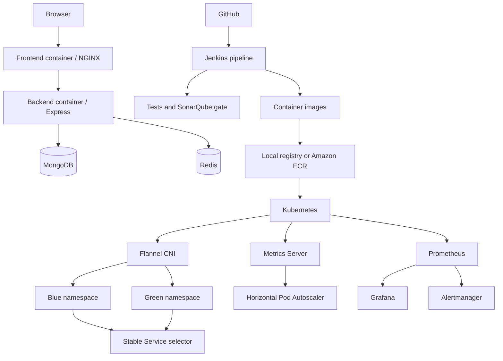

# Veltrix Implementation Plan

## 1. Purpose and Delivery Decision

Veltrix is a React/Vite frontend with a Node.js/Express backend, MongoDB, Redis,
Docker, Kubernetes, Flannel CNI, Helm, Jenkins, SonarQube, Prometheus, Grafana,
and AWS infrastructure.

The implementation has two delivery levels:

| Level | What it proves | Final submission status |
|---|---|---:|
| **Level A: Local preparation** | The application works, images build, tests pass, Kubernetes manifests work, Flannel is used for pod networking, and the CI/CD design is ready | **Not sufficient alone** |
| **Level B: Required final submission** | The same system runs on AWS with Terraform, Ansible, ECR, Jenkins, blue-green traffic, autoscaling, monitoring, and recorded evidence | **Required** |

### Direct answer

**You can develop the application without AWS, but you must deploy the final
system to AWS for this project because the team needs to demonstrate the AWS
services, Jenkins, Kubernetes, and the recorded end-to-end pipeline.** Use local
Docker Compose for early development, then deploy the validated system to AWS
before recording the final videos.

**You need deployment only if the evaluation requires proof of AWS resources,
public access, ECR, a remote Jenkins server, cloud blue-green releases, or cloud
monitoring.** Finish Level A first, then perform Level B if AWS credits, time,
and access are available. Local development is preparation; it is not a
replacement for the final cloud demonstration.

Flannel CNI is retained and must not be removed. It remains the network plugin
for the kubeadm cluster:

```text
Kubernetes cluster -> Flannel CNI -> Pod network 10.244.0.0/16
```

Jenkins is scheduled after the application, containers, and Kubernetes manifests
are stable. Jenkins is not required to start development.

---

## 2. Scope and Non-Goals

### In scope

- Run and verify the existing frontend and backend.
- Use MongoDB and Redis through Docker Compose.
- Build production-style backend and frontend images.
- Run backend tests and frontend build checks.
- Package Kubernetes resources for blue-green releases.
- Keep Flannel as the CNI for the Kubernetes cluster.
- Add HPA, Metrics Server, Helm, Prometheus, Grafana, and Alertmanager as
  demonstrable DevOps capabilities.
- Add Jenkins as a later CI/CD automation layer.
- Provision AWS resources with Terraform only when Level B is required.

### Out of scope for the first working version

- Rewriting application features unrelated to the DevOps deliverable.
- Replacing Flannel with Calico, Cilium, Weave Net, or a managed CNI.
- Building a production-grade multi-region platform.
- Committing secrets, cloud access keys, kubeconfig files, or `.env` files.

---

## 3. Three-Member Ownership and Video Plan

| Owner | Responsibility | Main outputs |
|---|---|---|
| Member | Implementation ownership | AWS services owned | Videos owned |
|---|---|---|---|
| **Aayush** | Cloud foundation, Kubernetes, networking, and releases | EC2, ALB, Route 53/ACM | V4, V5, V6 |
| **Member 2** | CI/CD, containers, code quality, and observability | CodePipeline/CodeBuild, CloudWatch | V1, V2, V3 |
| **Member 3** | Security, storage, data, caching, and automation | S3, DocumentDB, IAM, ElastiCache | V7, V8, V9 |

### Aayush: Cloud and Kubernetes lead

- Provision the VPC, public/private subnets, route tables, and security groups.
- Provision EC2 hosts for Jenkins, Kubernetes, monitoring, and the bastion.
- Configure the Application Load Balancer and Kubernetes ingress path.
- Configure Route 53 and ACM only after the application is reachable through the
   ALB and the domain is available.
- Initialize kubeadm, retain Flannel CNI, join worker nodes, and verify
   `10.244.0.0/16` pod networking.
- Own blue-green Service switching, rollback, and the final public demo route.

### Member 2: CI/CD and observability lead

- Own the backend and frontend multi-stage Dockerfiles and image tagging.
- Configure Jenkins, GitHub webhook integration, SonarQube, and quality gates.
- Implement the pipeline stages for checkout, tests, scan, build, registry push,
   and deployment approval.
- Configure CodePipeline/CodeBuild if the AWS implementation requires both AWS
   CI services and Jenkins; document which system is the source of truth.
- Configure CloudWatch logs, metrics, alarms, and dashboards alongside
   Prometheus and Grafana.
- Own pipeline failure and recovery evidence.

### Member 3: Security, data, and automation lead

- Configure IAM roles and least-privilege policies for EC2, Jenkins, and pods.
- Configure S3 for repository objects and pre-signed uploads.
- Configure DocumentDB as the cloud MongoDB-compatible data option, or document
   MongoDB as the approved demonstration database if DocumentDB is not available.
- Configure ElastiCache Redis for Socket.io adapter and cache use.
- Implement Ansible playbooks for repeatable host configuration and hardening.
- Implement Helm charts, Metrics Server, HPA, load testing, and security checks.

### Shared rule for all three members

The owner implements and demonstrates each assigned area, while the other two
members review the pull request, repeat the verification command, and appear in
the final rehearsal where their component affects the shared pipeline. No person
is responsible for only documentation or only video editing.

### Complete AWS and DevOps tool assignment

| # | Service/tool | Implementation owner | Required evidence |
|---:|---|---|---|
| 1 | Amazon EC2 | Aayush | Running Jenkins, Kubernetes, monitoring, and bastion hosts |
| 2 | Amazon S3 | Member 3 | Secure object upload or repository artifact storage |
| 3 | Amazon DocumentDB | Member 3 | Cloud MongoDB-compatible database connection, if selected |
| 4 | Amazon CloudFront | Member 2 | Frontend distribution and cache behavior |
| 5 | Application Load Balancer | Aayush | Public HTTP/HTTPS route to the application |
| 6 | AWS IAM | Member 3 | Roles, policies, and no hardcoded cloud keys |
| 7 | AWS CodePipeline/CodeBuild | Member 2 | AWS-native build or documented Jenkins integration |
| 8 | Amazon ElastiCache Redis | Member 3 | Cache and Socket.io shared adapter connection |
| 9 | Amazon CloudWatch | Member 2 | Logs, metrics, alarms, and dashboard |
| 10 | Route 53 and ACM | Aayush | DNS record and HTTPS certificate, if domain is available |
| 11 | Terraform | Aayush | Repeatable infrastructure plan and apply |
| 12 | Ansible | Member 3 | Idempotent host configuration playbooks |
| 13 | Docker and Docker Compose | Member 2 | Local stack and production images |
| 14 | Kubernetes kubeadm | Aayush | Control plane, workers, Services, and namespaces |
| 15 | Flannel CNI | Aayush | Healthy pods and node-to-node pod networking |
| 16 | Helm | Member 3 | Versioned chart and blue-green values |
| 17 | Jenkins | Member 2 | Seven-stage pipeline and webhook execution |
| 18 | SonarQube | Member 2 | Quality gate blocks a failing change |
| 19 | Prometheus/Grafana/Alertmanager | Member 2 | Dashboards and incident alert |
| 20 | Metrics Server/HPA | Member 3 | Scale-out and scale-in under controlled load |

### Three videos per member

| Video | Presenter | Subject | What must be shown |
|---|---|---|---|
| **V1** | Member 2 | Jenkins CI/CD pipeline | GitHub webhook, checkout, tests, image build, and successful stages |
| **V2** | Member 2 | SonarQube and security gate | Analysis result, quality gate, intentional failure, and repaired build |
| **V3** | Member 2 | Observability | CloudWatch/Prometheus metrics, Grafana dashboard, and an alert firing |
| **V4** | Aayush | Terraform and AWS foundation | `terraform plan/apply`, EC2/VPC resources, and security boundaries |
| **V5** | Aayush | Kubernetes and Flannel | kubeadm nodes, Flannel pods, `10.244.0.0/16`, Services, and healthy workloads |
| **V6** | Aayush | Blue-green release | Green rollout, stable Service switch, continuous requests, and rollback |
| **V7** | Member 3 | IAM, S3, database, and Redis | IAM role use, S3 object flow, DocumentDB/MongoDB data, and ElastiCache Redis |
| **V8** | Member 3 | Helm and autoscaling | Helm install/upgrade, Metrics Server, HPA scale-out, and scale-in |
| **V9** | Member 3 | Ansible and security | Inventory, idempotent second run, host hardening, and image/dependency scan |

Each video should include: the objective, the relevant command or UI, the
successful result, one failure or security control where applicable, and a
short explanation of why the tool is used. Do not record secrets, access keys,
tokens, passwords, or private key contents.

Every phase should be reviewed by at least one other member before it is marked
complete.

---

## 4. Target Architecture



Required boundaries:

1. Application: frontend, backend, MongoDB, and Redis.
2. Container: separate backend and frontend images with health checks.
3. Cluster: Kubernetes workloads communicate through Services; pod-to-pod
   traffic is provided by Flannel.
4. Release: the stable Service points to either blue or green.
5. Automation: Jenkins builds and validates artifacts; deployment is enabled
   only when cluster credentials and a target cluster exist.

---

## 5. Phase 0: Repository and Secret Hygiene

**Owner:** All members
**Goal:** Establish a clean baseline before adding infrastructure.

### Tasks

1. Confirm the repository builds from a clean checkout.
2. Confirm `.gitignore` excludes `.env`, credentials, kubeconfig files, build
   output, and `node_modules`.
3. Create `backend/.env.example` and
   `frontend/vite-project/.env.example` instead of real secrets.
4. Record supported Node.js, Docker, and Kubernetes versions.
5. Use a Git SHA or Jenkins build number for image tags.

### Verification

```bash
git status
node --version
docker --version
docker compose config
```

**Exit criteria:** no secret is tracked, Compose parses successfully, and the
team agrees on the commands used in later phases.

---

## 6. Phase 1: Local Application Baseline

**Owner:** Member 2
**Goal:** Prove the application works before containers or cloud resources are
introduced.

### Tasks

1. Install dependencies in `backend/` and `frontend/vite-project/`.
2. Configure local MongoDB and Redis values.
3. Start the backend and confirm the health endpoint.
4. Start the Vite frontend and verify it can call the backend.
5. Run the existing backend tests.
6. Run the frontend production build.

### Verification

```bash
cd backend
npm ci
npm test -- --passWithNoTests

cd ../frontend/vite-project
npm ci
npm run build
```

The backend health check should return HTTP 200. The frontend build must create
`dist/` without errors.

**Exit criteria:** local application startup, backend tests, and frontend build
all pass without AWS or Jenkins.

---

## 7. Phase 2: Docker Compose Integration

**Owner:** Member 2 with Aayush
**Goal:** Run the complete application stack as one local reproducible system.

### Services

| Service | Purpose | Local port |
|---|---|---:|
| `mongodb` | Application data | `27017` |
| `redis` | Cache and real-time adapter support | `6379` |
| `backend` | Express API and Socket.io | `5000` |
| `frontend` | Built React app served by NGINX | `8080` |

### Tasks

1. Build backend and frontend images from the repository Dockerfiles.
2. Use Compose health checks for MongoDB, Redis, backend, and frontend.
3. Use service DNS names for internal URLs, not `localhost`.
4. Keep a development-only JWT secret in Compose and document that it is not a
   production secret.
5. Verify browser access through `http://localhost:8080` and API access through
   `http://localhost:5000`.

### Verification

```bash
docker compose build
docker compose up -d
docker compose ps
curl http://localhost:5000/health
curl -I http://localhost:8080
docker compose logs --tail=100 backend frontend
docker compose down
```

**Exit criteria:** all four services become healthy and the main user flow can
be demonstrated locally.

---

## 8. Phase 3: Container Hardening and Image Contract

**Owner:** Member 2
**Goal:** Produce predictable images that work locally and in Kubernetes.

### Backend image requirements

- Use a multi-stage Node.js build where practical.
- Run the application as a non-root user.
- Set `NODE_ENV=production` in the runtime stage.
- Expose the actual application port.
- Add a health check matching the real backend endpoint.
- Never copy local `.env` files into the image.

### Frontend image requirements

- Build the Vite application in a Node.js builder stage.
- Serve generated assets with NGINX.
- Support SPA fallback to `index.html`.
- Configure API and Socket.io URLs for the deployment target.

### Image contract

```text
veltrix-backend:<git-sha>
veltrix-frontend:<git-sha>
```

The same image tag must be used during a test, deployment, and rollback. A local
registry may be used for Level A. Amazon ECR is used for Level B.

### Verification

```bash
docker build -t veltrix-backend:local ./backend
docker build -t veltrix-frontend:local ./frontend/vite-project
docker image inspect veltrix-backend:local
docker image inspect veltrix-frontend:local
```

**Exit criteria:** both images build reproducibly, start successfully, and do
not contain repository secrets.

---

## 9. Phase 4: Local Kubernetes and Flannel CNI

**Owner:** Aayush
**Goal:** Validate Kubernetes resources while preserving Flannel as the CNI.

### Cluster options

For Level A, use a Linux VM running kubeadm, a disposable local multi-node
cluster that supports the Flannel manifest, or a remote development cluster the
team controls.

For Level B, use a self-managed kubeadm cluster on EC2. Do not install a second
CNI. Initialize the cluster with the Flannel pod CIDR:

```bash
sudo kubeadm init --pod-network-cidr=10.244.0.0/16
```

Then apply the pinned Flannel manifest selected by the team:

```bash
kubectl apply -f <approved-flannel-manifest>.yaml
```

### Flannel requirements

1. Use pod CIDR `10.244.0.0/16` consistently between kubeadm and Flannel.
2. Allow VXLAN traffic between nodes, normally UDP port `8472` in AWS security
   groups.
3. Confirm CoreDNS becomes healthy after Flannel is ready.
4. Confirm nodes become `Ready` before installing application workloads.
5. Document the Flannel version and manifest source in the final report.

### Verification

```bash
kubectl get nodes -o wide
kubectl get pods -n kube-flannel
kubectl get pods -n kube-system
kubectl get nodes
```

**Exit criteria:** all nodes are `Ready`, Flannel pods run on every node, and
CoreDNS is healthy. This phase proves Flannel has been retained.

---

## 10. Phase 5: Kubernetes Application Manifests

**Owner:** Aayush with Member 3
**Goal:** Deploy the application independently of Jenkins.

### Required resources

- Namespaces `blue` and `green`.
- Backend and frontend Deployments and Services.
- Stable application Service or Ingress.
- ConfigMaps for non-sensitive configuration.
- Secrets for runtime credentials, created outside Git.
- Readiness and liveness probes.
- Resource requests and limits.
- Pod labels including `app` and `env`.

### Required label contract

```yaml
metadata:
  labels:
    app: veltrix
    env: blue
```

The stable Service must select exactly one release color at a time. Database and
Redis connection strings must use Kubernetes Services, never pod IPs.

### Verification

```bash
kubectl apply --dry-run=client -f infrastructure/k8s/
kubectl apply -f infrastructure/k8s/
kubectl get deployments,pods,svc -A
kubectl describe pod <pod-name> -n blue
kubectl logs deployment/veltrix-backend -n blue
```

**Exit criteria:** both application containers become Ready and the frontend
reaches the backend through the intended Service path.

---

## 11. Phase 6: Helm Packaging and Blue-Green Releases

**Owner:** Member 3 with Aayush
**Goal:** Make releases repeatable and reversible.

### Helm chart requirements

Create a chart such as `infrastructure/helm/veltrix/` with:

- `Chart.yaml`
- `values.yaml`
- `values-blue.yaml`
- `values-green.yaml`
- Deployment and Service templates
- ConfigMap and Secret templates that do not hardcode credentials
- Optional HPA and Ingress templates

### Release procedure

1. Build and tag new images.
2. Deploy the new version to the inactive color.
3. Wait for readiness probes and rollout completion.
4. Run smoke tests against the inactive color.
5. Change the stable Service selector to the new color.
6. Monitor application and infrastructure metrics.
7. Roll back the Service selector and Helm release if verification fails.

### Verification

```bash
helm lint infrastructure/helm/veltrix
helm template veltrix infrastructure/helm/veltrix -f infrastructure/helm/veltrix/values-blue.yaml
helm upgrade --install veltrix-blue infrastructure/helm/veltrix --namespace blue --create-namespace
kubectl rollout status deployment/veltrix-backend -n blue --timeout=5m
kubectl patch service veltrix-service -n blue -p '{"spec":{"selector":{"env":"blue"}}}'
```

**Exit criteria:** a release moves between blue and green without manifest
editing and can be rolled back with one documented command.

---

## 12. Phase 7: Metrics Server and HPA

**Owner:** Member 3
**Goal:** Demonstrate scaling based on resource utilization.

### Tasks

1. Install Metrics Server compatible with the selected Kubernetes version.
2. Add CPU and memory requests to the backend Deployment.
3. Create an HPA targeting the backend Deployment.
4. Set conservative minimum and maximum replica counts.
5. Generate controlled load only in a test environment.

### Verification

```bash
kubectl top nodes
kubectl top pods -A
kubectl get hpa -A
kubectl describe hpa veltrix-backend -n blue
```

**Exit criteria:** metrics are available and HPA changes desired replicas under
controlled load, then scales down after cooldown.

---

## 13. Phase 8: Jenkins and SonarQube CI/CD

**Owner:** Member 2
**Goal:** Automate repeatable validation and artifact creation. Jenkins is done
after the manual workflow is proven.

### Jenkins modes

| Mode | Required resources | Use |
|---|---|---|
| **Level A local** | Jenkins in Docker or a local VM, local Docker, optional local registry | Checkout, tests, scan, image build, and artifact publication |
| **Level B cloud** | Jenkins server, ECR, kubeconfig, target cluster | Webhook-triggered ECR publication and Kubernetes release |

### Pipeline stages

1. Checkout source.
2. Install dependencies with lockfiles.
3. Run backend tests and frontend build.
4. Run SonarQube analysis and enforce the quality gate.
5. Build backend and frontend images with the Git SHA tag.
6. Publish images to the selected local registry or Amazon ECR.
7. Deploy with Helm only when a deployment target is configured.
8. Wait for rollout and run smoke tests.
9. Archive logs and publish the result.

The deployment stage must be controlled by an explicit parameter or environment
flag such as `DEPLOY_ENABLED`. A test-only pipeline must not fail merely because
AWS credentials or a kubeconfig are absent.

### Credentials

Store credentials in Jenkins credentials storage. Never place them in the
Jenkinsfile, GitHub, Dockerfiles, or Kubernetes manifests. Minimum cloud
credentials are GitHub access, SonarQube token, registry access, and cluster
authentication.

### Verification

```bash
git diff --check
docker compose config
```

Run one successful Jenkins build and one intentionally failing quality or test
build. The failure must stop before image publication or deployment.

**Exit criteria:** Jenkins validates the repository and produces tagged images.
Deployment is enabled only after the target cluster is reachable.

---

## 14. Phase 9: Observability and Security

**Owner:** Member 2 with Member 3
**Goal:** Make failures visible and reduce avoidable exposure.

### Observability

- Prometheus scrapes Kubernetes and application metrics.
- Grafana includes application health, pod count, CPU/memory, restarts, and
  rollout status.
- Alertmanager routes pod crash-loop, unavailable replica, high CPU, and failed
  rollout alerts.
- Logs include enough request and error context to diagnose failed releases.

### Security

- Restrict AWS security groups to required ports and trusted source ranges.
- Use IAM roles or short-lived credentials instead of keys in source code.
- Keep cluster API access private where possible.
- Restrict Kubernetes RBAC for Jenkins to required namespaces and verbs.
- Scan images and review dependency vulnerabilities.
- Rotate demo credentials before any public deployment.

### Verification

```bash
kubectl get --raw /apis/metrics.k8s.io/v1beta1/nodes
kubectl get servicemonitors,prometheusrules -A
docker scout cves veltrix-backend:local
```

**Exit criteria:** a deliberate failed pod or unavailable replica generates a
visible alert, and no secret appears in Git history or image layers.

---

## 15. Phase 10: Required AWS Deployment and Final Recording

**Owner:** Aayush with all members
**Goal:** Provide cloud evidence when Level B is required.

This phase is required for the final project demonstration because the team
must show the AWS services and record the deployed Jenkins-to-Kubernetes flow.
Local Docker and Kubernetes work from earlier phases remains useful for fast
development and troubleshooting.

### Terraform resources

- VPC, public and private subnets, route tables, and NAT where needed.
- Security groups for bastion, Kubernetes nodes, Jenkins, registry access, and
  monitoring.
- EC2 instances or another approved compute layout.
- IAM roles with least privilege.
- ECR repositories for backend and frontend images.
- Optional ALB and DNS resources.

### Ansible configuration

- Common packages and security baseline.
- Container runtime and Kubernetes prerequisites.
- Java and Jenkins host prerequisites where required.
- Node Exporter installation.
- Idempotent execution and a second-run check showing no unnecessary changes.

### AWS Kubernetes sequence

1. Apply Terraform and review the plan.
2. Configure nodes with Ansible.
3. Initialize the control plane with pod CIDR `10.244.0.0/16`.
4. Join workers.
5. Apply Flannel and verify node readiness.
6. Install Metrics Server and monitoring.
7. Deploy the Helm chart.
8. Connect Jenkins to ECR and the cluster.
9. Run a blue-green release and rollback rehearsal.
10. Destroy non-required resources after the demonstration to control cost.

### AWS verification

```bash
terraform fmt -check
terraform validate
terraform plan
ansible-playbook --check -i inventory.ini playbooks/site.yml
kubectl get nodes
kubectl get pods -n kube-flannel
kubectl get pods -A
```

**Exit criteria:** the cloud deployment is reachable, the pipeline publishes and
deploys a tagged image, Flannel is healthy, and rollback is demonstrated.

---

## 16. Final Test and Demonstration Checklist

### Level A: Local preparation

- [ ] Clean checkout installs successfully.
- [ ] Backend tests pass.
- [ ] Frontend production build passes.
- [ ] Docker Compose starts MongoDB, Redis, backend, and frontend.
- [ ] Backend and frontend images build.
- [ ] Local Kubernetes cluster is healthy.
- [ ] Flannel pods are healthy and CoreDNS is ready.
- [ ] Blue and green manifests deploy.
- [ ] Helm lint and template checks pass.
- [ ] Manual blue-green switching and rollback work.
- [ ] Metrics Server and HPA are verified where supported.
- [ ] Jenkins runs tests, scans, and builds images locally or on a temporary host.
- [ ] No credentials are committed.

### Level B: Required AWS demonstration

- [ ] Terraform plan reviewed and applied.
- [ ] Ansible completes successfully and is idempotent.
- [ ] ECR receives immutable Git SHA tags.
- [ ] Jenkins webhook triggers a successful pipeline.
- [ ] Kubernetes cluster uses Flannel with `10.244.0.0/16`.
- [ ] Blue-green release reaches the new version.
- [ ] Rollback restores the previous version.
- [ ] HPA scales under controlled load.
- [ ] Grafana dashboards and Alertmanager alerts are demonstrated.
- [ ] All nine videos are recorded with clear evidence and no exposed secrets.
- [ ] AWS resources are stopped or destroyed after the demonstration where safe.

---

## 17. Recommended Execution Order

```text
Local app
  -> Docker Compose
  -> Container images
  -> Kubernetes + Flannel
  -> Kubernetes manifests
  -> Helm and blue-green release
  -> Metrics Server and HPA
  -> Jenkins and SonarQube
  -> Observability and security
   -> Required AWS deployment and nine video recordings
```

Do not block early application development on AWS provisioning or Jenkins setup.
However, before final submission, complete Level B so the team can prove the
AWS services, deployed DevOps tools, and nine assigned videos.
